<picture>
  <source media="(prefers-color-scheme: dark)" srcset="https://raw.githubusercontent.com/moelayachi/moelayachi/main/dark.svg">
  <source media="(prefers-color-scheme: light)" srcset="https://raw.githubusercontent.com/moelayachi/moelayachi/main/light.svg">
  
</picture>

## 🚀 Projects

- **Taawon**: a website for Moroccan artisan cooperatives, designed in Figma (5 pages) and built with HTML and Tailwind CSS
- [**Book Library**]: A JavaScript-based web application to manage a personal book collection, with features like adding, editing, deleting, searching, sorting, and saving books locally.

## 🛠️ Tech & tools

     

<!--
STEP 2 (after you deploy your own github-readme-stats on Vercel):
replace YOUR-INSTANCE with your Vercel URL, then delete this comment markers.

-->

<!--
STEP 3 (only after the "Generate Snake Animation" Action has run green once):
delete these comment markers to show the snake.

<picture>
  <source media="(prefers-color-scheme: dark)" srcset="https://raw.githubusercontent.com/moelayachi/moelayachi/output/github-snake-dark.svg" />
  <source media="(prefers-color-scheme: light)" srcset="https://raw.githubusercontent.com/moelayachi/moelayachi/output/github-snake.svg" />
  
</picture>

-->
